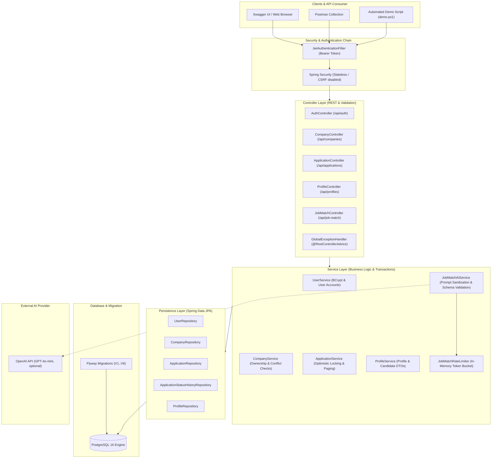

# JobTrail

[](https://github.com/melina-danhier/job-trail/actions/workflows/ci.yml)


**Eine produktionsnah aufgebaute REST-API, die Bewerbungen benutzerspezifisch verwaltet, Statusverläufe auditierbar nachvollzieht und Stellenbeschreibungen optional per KI mit dem eigenen Bewerberprofil abgleicht.**

---

## 🚀 Schnellzugriff & Dokumentation

| Ressource | URL / Pfad | Beschreibung |
| --- | --- | --- |
| 📖 **Swagger UI (interaktiv)** | [`http://localhost:8080/swagger-ui/index.html`](http://localhost:8080/swagger-ui/index.html) | Interaktive API-Konsole mit JWT-Authorize-Button (`Bearer <TOKEN>`) |
| 📄 **OpenAPI v3 Spezifikation** | [`http://localhost:8080/v3/api-docs`](http://localhost:8080/v3/api-docs) | Maschinenlesbare OpenAPI 3.0 Spezifikation im JSON-Format |
| 📬 **Postman Collection & Env** | [`postman/README.md`](postman/README.md) | Vorkonfigurierte Requests, 1-Klick Demo-Login & 14 automatisierte Fehlertests |
| ⚡ **Automatisierte CLI-Demo** | [`scripts/demo.ps1`](scripts/demo.ps1) | 9-stufiger PowerShell-End-to-End-Testlauf mit Zusicherungen |
| 🚦 **CI Pipeline Status** | [GitHub Actions Workflow](https://github.com/melina-danhier/job-trail/actions/workflows/ci.yml) | Automatisierter Build & Postgres-Integrationstests bei jedem Push |

---

## 🏛️ Architektur & Schichtenmodell

JobTrail folgt einer sauberen, modularen Schichtenarchitektur mit strikter Trennung von REST-Transportobjekten (DTOs), Fachlogik und JPA-Entities:



### Schichtenverantwortlichkeiten

1. **Controller Layer (`com.melina.jobtrail.controller`)**:
   - Definiert REST-Endpunkte mit OpenAPI-Annotationen (`@Operation`, `@ApiResponse`).
   - Führt Bean Validation (`@Valid`, `@NotBlank`, `@Size`, `@URL`) auf DTOs durch.
   - Enthält keinerlei Geschäftslogik oder Datenbankzugriffe.
2. **Global Exception Handler (`com.melina.jobtrail.exception.GlobalExceptionHandler`)**:
   - Wandelt alle fachlichen und technischen Ausnahmen in ein einheitliches JSON-Problem-Format (`ErrorResponse`) um.
   - Liefert detaillierte Feldvalidierungsfehler (`fieldErrors`) bei `400 Bad Request`.
3. **Service Layer (`com.melina.jobtrail.service`)**:
   - Steuert Transaktionen (`@Transactional`).
   - Garantiert **Tenant Isolation**: Jeder Benutzer hat ausschließlich Zugriff auf seine eigenen Firmen, Bewerbungen und Profile.
   - Kapselt Statusübergänge, erzeugt unveränderliche Statushistorien und schützt über `@Version` gegen parallele Schreibkonflikte (Optimistic Locking).
4. **Persistence Layer (`com.melina.jobtrail.repository`)**:
   - Spring Data JPA Interfaces mit typsicheren Methoden und optimierten JPQL-Abfragen (`LEFT JOIN FETCH`) zur Vermeidung des N+1-Problems.
   - Benutzerspezifische Indizes beschleunigen Abfragen nach Status, Datum und Firmenverknüpfungen.
5. **Datenbank & Migrationen (`src/main/resources/db/migration`)**:
   - Flyway verwaltet alle Schema-Änderungen versioniert und reproduzierbar (V1 bis V6).
   - Hibernate läuft mit `ddl-auto: validate` und modifiziert die Datenbankstruktur niemals eigenständig.

---

## 📋 Voraussetzungen

Für den vollständigen Betrieb werden benötigt:
- **Docker & Docker Compose** (Docker Desktop oder Docker Engine $\ge$ 24.x mit Compose v2)
- **Freie Host-Ports:**
  - `8080`: Spring Boot REST-API
  - `5433`: PostgreSQL Host-Port (Port 5433 verhindert Konflikte mit einer bereits lokal laufenden PostgreSQL-Instanz auf 5432)
- *(Nur für lokalen Maven-Start ohne Docker):* **JDK 21** (`java -version`). Eine globale Maven-Installation ist nicht nötig; der beiliegende Maven-Wrapper (`./mvnw` bzw. `.\mvnw.cmd`) wird verwendet.

---

## 🐳 Vollständiger Start mit Docker Compose

Die gesamte Umgebung (Spring Boot API + PostgreSQL 16) lässt sich mit Docker Compose reproduzierbar bauen und starten.

### 1. Umgebungskonfiguration vorbereiten

Kopieren Sie die Vorlage [`.env.example`](.env.example) in eine lokale Datei `.env`:

```powershell
# Windows (PowerShell)
Copy-Item .env.example .env

# macOS / Linux
cp .env.example .env
```

Die Standardwerte in `.env.example` sind sofort lokal lauffähig. Falls Sie das KI-Job-Matching nutzen möchten, tragen Sie in `.env` Ihren `OPENAI_API_KEY` ein.

### 2. Container bauen und im Hintergrund starten

```powershell
docker compose up -d --build
```

Compose führt automatisch folgende Schritte aus:
1. Startet den Container `jobtrail-postgres` mit PostgreSQL 16.
2. Führt einen Healthcheck (`pg_isready`) durch.
3. Baut das Multi-Stage-Docker-Image `jobtrail:local` mit Java 21.
4. Startet den Container `jobtrail-app`, sobald die Datenbank gesund (`healthy`) ist.
5. Flyway migriert das Schema automatisch auf die neueste Version (V1..V6).

### 3. Status und Logs prüfen

```powershell
# Container-Status prüfen
docker compose ps

# Live-Logs der Spring Boot Anwendung einsehen
docker compose logs -f app
```

Sobald in den Logs `Started JobTrailApplication in ... seconds` erscheint, ist die API unter `http://localhost:8080` bereit.

### 4. Beenden und Bereinigen

```powershell
# Anwendung und Datenbank stoppen (Daten bleiben im Docker-Volume erhalten)
docker compose down

# Vollständiger Reset: Stoppt Container und löscht das Datenbank-Volume
docker compose down -v
```

---

## 💻 Lokales Entwicklungs-Setup (Docker + Maven)

Für Entwickler, die den Spring Boot Server lokal im Debug-Modus ausführen möchten:

1. **Nur die PostgreSQL-Datenbank im Container starten:**
   ```powershell
   docker compose up -d postgres
   ```

2. **Laufzeit-Umgebungsvariablen setzen & Backend starten:**

   *Windows (PowerShell):*
   ```powershell
   $env:SPRING_PROFILES_ACTIVE = "dev"
   $env:JWT_SECRET = "mein-super-langes-geheimes-passwort-mit-mindestens-32-zeichen"
   .\mvnw.cmd spring-boot:run
   ```

   *macOS / Linux:*
   ```bash
   export SPRING_PROFILES_ACTIVE=dev
   export JWT_SECRET="mein-super-langes-geheimes-passwort-mit-mindestens-32-zeichen"
   ./mvnw spring-boot:run
   ```

3. **Testsuite ausführen (228 Unit-, Controller- und Service-Tests):**
   ```powershell
   .\mvnw.cmd test "-Dtest=ApplicationControllerTest,AuthControllerTest,CompanyControllerTest,JobMatchControllerTest,ProfileControllerTest,AccessControlSecurityWebTest,JwtAuthFilterTest,ApplicationServiceTest,CompanyServiceTest,JobMatchAiServiceTest,JobMatchRateLimiterTest,ProfileServiceTest,UserServiceTest,JwtUtilTest"
   ```

---

## ⚙️ Konfiguration & Umgebungsvariablen

Alle Kernparameter werden über Umgebungsvariablen gesteuert (siehe [`.env.example`](.env.example)):

| Variable | Erforderlich | Standardwert | Beschreibung |
| --- | :---: | --- | --- |
| `POSTGRES_DB` | ja | `jobtrail` | Name der PostgreSQL-Datenbank |
| `DB_USERNAME` | ja | `postgres` | Datenbank-Benutzername |
| `DB_PASSWORD` | ja | `postgres_dev_password_change_in_prod` | Datenbank-Passwort |
| `DB_PORT` | nein | `5433` | Host-Port für PostgreSQL |
| `SERVER_PORT` | nein | `8080` | Port der Spring Boot REST-API |
| `SPRING_PROFILES_ACTIVE` | nein | `prod` (Docker) / `dev` (Lokal) | Aktives Spring-Profil |
| `JWT_SECRET` | ja | *(Mindestens 32 Zeichen)* | HMAC-SHA256 Signaturschlüssel für JWTs |
| `JWT_EXPIRATION` | nein | `PT1H` (1 Stunde) | Token-Gültigkeitsdauer (ISO-8601 Dauer) |
| `JWT_ISSUER` | nein | `jobtrail` | Erwarteter Issuer-Claim im Token |
| `OPENAI_API_KEY` | nein | `""` (deaktiviert) | OpenAI API-Key für KI-Job-Matching |
| `JOB_MATCH_REQUESTS_PER_MINUTE` | nein | `5` | Rate-Limit für KI-Anfragen pro Benutzer |
| `SPRINGDOC_SWAGGER_UI_ENABLED` | nein | `true` | Aktiviert Swagger UI |
| `SPRINGDOC_API_DOCS_ENABLED` | nein | `true` | Aktiviert OpenAPI v3 JSON-Spezifikation |

---

## 🔐 Authentifizierung & API-Workflow

Die Authentifizierung erfolgt stateless über JWT Bearer Tokens. Nach Registrierung und Login wird das erhaltene Token im HTTP-Header mitgesendet:
`Authorization: Bearer <TOKEN>`

### 1. Registrierung & Login

**Registrierung:**
```http
POST /api/auth/register
Content-Type: application/json

{
  "email": "candidate@example.invalid",
  "password": "secure-password-123"
}
```
*Antwort (`201 Created`):*
```json
{
  "id": 1,
  "email": "candidate@example.invalid",
  "createdAt": "2026-10-27T20:00:00Z"
}
```

**Login:**
```http
POST /api/auth/login
Content-Type: application/json

{
  "email": "candidate@example.invalid",
  "password": "secure-password-123"
}
```
*Antwort (`200 OK`):*
Gibt den signierten JWT als reinen Text (`text/plain`) zurück.

**Aktuellen Benutzer abrufen:**
```http
GET /api/auth/me
Authorization: Bearer <TOKEN>
```

---

### 2. Typischer End-to-End API-Ablauf

#### Schritt 1: Firma anlegen
```http
POST /api/companies
Authorization: Bearer <TOKEN>
Content-Type: application/json

{
  "name": "CloudTech Solutions GmbH",
  "website": "https://example.com",
  "location": "Berlin / Remote"
}
```
*Antwort (`201 Created`):* Liefert die ID der neu erstellten Firma (z. B. `{"id": 42, ...}`).

#### Schritt 2: Bewerbung erfassen
Der Anfangsstatus wird vom Server immer atomar auf `SAVED` gesetzt:
```http
POST /api/applications
Authorization: Bearer <TOKEN>
Content-Type: application/json

{
  "positionTitle": "Senior Java Backend Engineer",
  "companyId": 42,
  "applicationDate": "2026-10-27",
  "jobUrl": "https://example.com/jobs/java-senior"
}
```
*Antwort (`201 Created`):* Liefert die Bewerbung mit `status: "SAVED"`.

#### Schritt 3: Bewerbungen filtern, sortieren & paginieren
```http
GET /api/applications?status=SAVED&companyId=42&sortBy=applicationDate&direction=desc&page=0&size=10
Authorization: Bearer <TOKEN>
```
*Antwort (`200 OK`):* Liefert ein Page-Objekt mit `content`, `page`, `size`, `totalElements` und `totalPages`.

#### Schritt 4: Statuswechsel durchführen
Statusübergänge erfolgen ausschließlich über den dedizierten PATCH-Endpunkt, um die Nachvollziehbarkeit sicherzustellen:
```http
PATCH /api/applications/1/status
Authorization: Bearer <TOKEN>
Content-Type: application/json

{
  "status": "INTERVIEW_SCHEDULED"
}
```
*Erlaubte Statuswerte:* `SAVED` $\rightarrow$ `APPLIED` $\rightarrow$ `UNDER_REVIEW` $\rightarrow$ `INTERVIEW_SCHEDULED` $\rightarrow$ `INTERVIEW_COMPLETED` $\rightarrow$ `OFFER_RECEIVED` $\rightarrow$ `ACCEPTED`, `REJECTED`, `WITHDRAWN`.

#### Schritt 5: Auditierbare Statushistorie abrufen
```http
GET /api/applications/1/status-history
Authorization: Bearer <TOKEN>
```
*Antwort (`200 OK`):*
```json
[
  {
    "id": 1,
    "oldStatus": null,
    "newStatus": "SAVED",
    "changedAt": "2026-10-27T20:05:00Z"
  },
  {
    "id": 2,
    "oldStatus": "SAVED",
    "newStatus": "INTERVIEW_SCHEDULED",
    "changedAt": "2026-10-27T20:10:00Z"
  }
]
```

#### Schritt 6: Bewerberprofil für KI-Matching pflegen
```http
POST /api/profiles
Authorization: Bearer <TOKEN>
Content-Type: application/json

{
  "targetRole": "Java Backend Developer",
  "locationPreference": "Berlin / Remote",
  "availability": "ab sofort",
  "experienceLevel": "MID_LEVEL",
  "summary": "Fokus auf hochperformante Spring-Boot-Architekturen",
  "skills": [
    { "name": "Java", "level": "EXPERT", "mainSkill": true },
    { "name": "Spring Boot", "level": "PROFICIENT", "mainSkill": true },
    { "name": "PostgreSQL", "level": "PROFICIENT", "mainSkill": true }
  ],
  "languages": [
    { "language": "Deutsch", "level": "NATIVE" },
    { "language": "Englisch", "level": "FLUENT" }
  ],
  "projects": [],
  "preferredRoles": ["Backend Developer", "Software Architect"],
  "avoidKeywords": ["unbezahltes Praktikum", "On-Call 24/7"]
}
```

#### Schritt 7: KI-Job-Matching ausführen
```http
POST /api/job-match/analyze
Authorization: Bearer <TOKEN>
Content-Type: application/json

{
  "description": "Gesucht: Senior Java Entwickler (m/w/d). Aufgaben: Entwicklung modularer Microservices mit Java 21, Spring Boot und PostgreSQL. Erfahrung mit Docker und CI/CD gewünscht. Deutsch verhandlungssicher."
}
```
*Antwort (`200 OK`):*
```json
{
  "score": 88,
  "matchingSkills": ["Java", "Spring Boot", "PostgreSQL"],
  "missingSkills": ["Docker", "CI/CD"],
  "recommendation": "APPLY",
  "summary": "Das Bewerberprofil passt hervorragend zu den Kernanforderungen der Position. Die Kerntechnologien Java, Spring Boot und PostgreSQL werden vollständig abgedeckt. Die geforderten Sprachkenntnisse stimmen überein."
}
```

---

## 🛡️ Einheitliche Fehlerbehandlung

Alle Fehler werden zentral von [`GlobalExceptionHandler`](src/main/java/com/melina/jobtrail/exception/GlobalExceptionHandler.java) in einem konsistenten JSON-Format zurückgegeben:

```json
{
  "timestamp": "2026-10-27T20:30:00Z",
  "status": 400,
  "error": "Bad Request",
  "message": "Validation failed",
  "fieldErrors": {
    "positionTitle": "Position title cannot be null or blank",
    "companyId": "Company ID must be provided"
  }
}
```

### Übersicht der HTTP-Statuscodes

| Statuscode | Typische Ursache | Beispielmeldung |
| --- | --- | --- |
| `400 Bad Request` | Fehlende Pflichtfelder, falsche Datentypen oder ungültige Paginierung | `Validation failed` (mit detaillierten `fieldErrors`) |
| `401 Unauthorized` | Kein, falscher oder abgelaufener JWT Bearer Token | `Unauthorized` |
| `403 Forbidden` | Versuch, auf fremde Daten zuzugreifen | `Access Denied` |
| `404 Not Found` | Angefragte ID existiert nicht oder gehört einem anderen Nutzer | `Application with id 99 not found` |
| `409 Conflict` | Duplikat (gleiche Firma + Titel) oder Löschen einer referenzierten Firma | `Company with id 42 cannot be deleted while applications reference it` |
| `429 Too Many Requests` | KI-Matching Rate-Limit überschritten | `AI job matching rate limit exceeded` |
| `502 Bad Gateway` | OpenAI-Providerfehler, Timeout oder ungültige LLM-Antwort | `AI service is temporarily unavailable` / `Failed to parse AI response` |
| `503 Service Unavailable` | KI-Matching aufgerufen, obwohl kein `OPENAI_API_KEY` gesetzt ist | `AI job matching is not configured` |

---

## 🧪 CI/CD & Teststrategie

JobTrail wird über eine automatisierte GitHub Actions CI-Pipeline ([`.github/workflows/ci.yml`](.github/workflows/ci.yml)) bei jedem Push und Pull Request geprüft.

```powershell
.\mvnw.cmd verify
```

- **Unit-Tests:** Isolieren Services, Mapper, JWT-Validierung und KI-Rate-Limiter mit Mockito.
- **Controller-Tests:** Testen Routing, Bean Validation, Statuscodes und das einheitliche `ErrorResponse`-Format via `MockMvc`.
- **Datenbank- & Migrationstests:** Testcontainers startet eine echte PostgreSQL-16-Instanz und validiert Flyway-Migrationen (V1..V6).
- **Security- & Access-Control-Tests:** Verifizieren strikte Benutzerisolation (kein Cross-User-Data-Leakage) und Token-Abläufe.
- **KI-Resilienz-Tests:** 29 dedizierte Tests in `JobMatchAiServiceTest` decken ungültige JSON-Antworten, fehlende Felder, widersprüchliche Bewertungsrubriken, Timeouts und Providerfehler ab.

---

## ⚠️ Bekannte Einschränkungen & MVP-Grenzen

- **Reine Backend-API:** Das Projekt stellt eine zustandslose REST-API bereit. Ein Frontend (z. B. React/Vue/Angular) kann über die dokumentierten JSON-Endpunkte angebunden werden.
- **Kein E-Mail-Versand / Passwort-Reset:** Registrierung und Login laufen direkt über die API ohne SMTP-Verifikation.
- **In-Memory Rate Limiting:** Das Token-Bucket-Rate-Limiting für KI-Anfragen läuft im Arbeitsspeicher der App-Instanz. Bei horizontaler Skalierung sollte Redis oder ein API-Gateway genutzt werden.
- **Optionale KI-Abhängigkeit:** Das KI-Job-Matching ist eine optionale Entscheidungshilfe. Ohne `OPENAI_API_KEY` bleibt der gesamte Kern (Firmen, Bewerbungen, Statushistorie, Profile) uneingeschränkt nutzbar.
